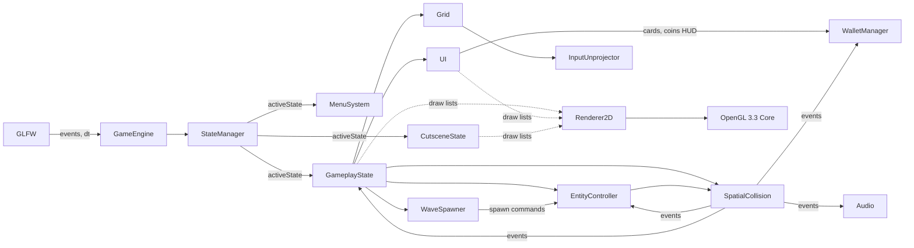

# PHASE 1 — Requirements Analysis & Architectural Modeling

**Course:** DMET 502 Computer Graphics (Winter 2026)
**Institution:** German University in Cairo (GUC) — Media Engineering and Technology
**Instructor:** Prof. Dr. Rimon Elias
**Submission Deadline:** Monday, November 2nd, 2026 @ 11:59 PM
**Team Structure:** Strictly 3–4 students
**Archive Naming:** `[Team Name]-[Member Name].zip`

---

## 1. Executive Overview

Phase 1 converts the official DMET 502 project specification into a complete architectural blueprint:

- A **traceability matrix** linking every PDF requirement to a subsystem and verification test.
- A **spatial coordinate model** (orthographic world space, lane geometry, unprojection math).
- **Entity data schemas** and an object-oriented class hierarchy.
- A **finite state machine** for application lifecycle.
- **Mathematical algorithms** for collision, evasion, shielding, and damage tinting.
- **Economy / UI / wave-spawner** rule models.
- A **directory architecture** and build strategy.

Establishing this blueprint before shader or build code enforces the core architectural principle: a clean separation between **CPU-side game simulation logic** and **GPU-side OpenGL 3.3 Core rendering calls**.

### Technological Stack (Locked)

| Layer | Choice | Constraint / Rationale |
|---|---|---|
| Language | C++17 | Required by spec; compiled with standard build tools |
| Graphics API | Modern OpenGL 3.3+ Core Profile | GLSL 330 core shaders only |
| Windowing / Input | GLFW 3 | Window creation, keyboard/mouse polling |
| GL Loader | GLAD | Runtime binding of OpenGL function pointers |
| Math | GLM | `glm::ortho`, vectors, matrices |
| Audio (Bonus) | miniaudio | Single-header `miniaudio.h` wrapper |
| Build | CMake | Master cross-platform compilation script |
| UI Text | stb_truetype / bitmap font | Numeric health + coin HUD rendering |

### Theme Selection (Creative Direction)

**Theme: "Neon Outpost — Sci-Fi Lab Defense."**
A rogue-Xeno swarm breaches a remote planetary research station. Players are Lab Guardians; the Home Base is the lab's **Reactor Core**. This theme supplies the required cohesive look across cutscene, environment (≥5 decor assets: machinery, pipes, containers, warning signs, computers, lab equipment), characters, and weapons — and grades on creativity + logical cutscene-to-gameplay connection.

---

## 2. Requirements Inventory & Traceability Matrix

> Sources: PDF §2 (Cutscene), §3.1 (Playfield), §3.2 (Player Logic), §3.3 (Enemy Logic), §3.4 (Win/Lose), §4 (Visuals), §4.3 (Menus), §5 (Bonus Audio), §6 (Video), §7 (Submission).

### 2.1 Functional Requirements

| Req ID | Spec § | Specification Description | Planned Subsystem Component | Verification Test Method | Status |
|---|---|---|---|---|---|
| REQ-F-001 | §2 | 10–20s fully animated cutscene with ≥1 player, ≥1 enemy, dialogue/subtitles + animation (not text-only) | `CutsceneState`, `StateManager` | Timed keyframe sequence test; assert duration ∈ [10,20]s; verify ≥2 animating sprites per frame | Modelled |
| REQ-F-002 | §2 | Cutscene establishes what is being defended and why (Reactor Core defense) | `CutsceneKeyframes` | Script storyboard review; subtitle timeline check | Modelled |
| REQ-F-003 | §3.1 | 2D side-view grid playfield with ≥3 horizontal lanes (design locks 4) | `GridSystem` | 4-lane coordinate audit vs constants | Modelled |
| REQ-F-004 | §3.1 | Home Base (safe zone) on far-left end, distinct and clearly visible | `GridSystem`, `GameplayState` | Spatial boundary $X_{home}$ check; distinct-rendering review | Modelled |
| REQ-F-005 | §3.1 | Enemies emerge at rightmost edge in a **randomly chosen lane**, advance left | `WaveSpawner` | Rightmost boundary $X_{spawn}$ check; lane RNG histogram test | Modelled |
| REQ-F-006 | §3.1 | Placed players auto-advance leftmost→right along chosen lane (except Defense) | `PlayerEntity`, `MovementSystem` | Velocity trace $x(t)=x_0+v_x\Delta t$ | Modelled |
| REQ-F-007 | §3.1 | Encounter collision: both combatants stop moving and attack until one is defeated | `SpatialCollision` | AABB overlap halt check; HP decay assertion | Modelled |
| REQ-F-008 | §3.1 | Lane locking: player may never switch lanes | `Entity` (base) | Fixed lane index $Y_{lane}$ invariant check | Modelled |
| REQ-F-009 | §3.1 | Attack actions start automatically upon placement/appearance | `CombatProcessor` | Auto-fire timer trace | Modelled |
| REQ-F-010 | §3.1 | Players may pass through players (no player-vs-player collision) | `SpatialCollision` | Filter test: friendly-friendlies ignored | Modelled |
| REQ-F-011 | §3.2 | Three player types: Melee / Ranged / Defense, visually distinct (not recolor-only) | `MeleePlayer`, `RangedPlayer`, `DefensePlayer`, model assets | Model-complexity design review | Modelled |
| REQ-F-012 | §3.2 | Purchase required before placement; Melee unlocked from start | `WalletManager`, `UIManager` | Starting-balance + card-state test | Modelled |
| REQ-F-013 | §3.2 | Start with enough coins for ≥3 Melee players (30 coins @ 10/melee) | `WalletManager` | HUD starting-balance trace = 30 | Modelled |
| REQ-F-014 | §3.2 | Ranged unlocks at 2× Melee collectibles; Defense at 3× | `WalletManager` | Unlock threshold boundary test (20 / 30 coins) | Modelled |
| REQ-F-015 | §3.2 | Lane hover highlights whole lane; click toggles selected/deselected; multiple lanes selectable | `GridSystem` | Hover rectangle mapping test; toggle state test | Modelled |
| REQ-F-016 | §3.2 | Player appears at leftmost of selected lane on card selection | `GameplayState` | Spawn X = 170.0f check | Modelled |
| REQ-F-017 | §3.2 | W/↑: jump (selected lanes); S/↓: duck (selected lanes) | `InputSystem`, `EvasionSystem` | Key-event → vertical displacement trace | Modelled |
| REQ-F-018 | §3.2 | Jump avoids low attacks; duck avoids high attacks | `EvasionSystem` | Projectile Y-band + dodge predicate unit test | Modelled |
| REQ-F-019 | §3.2 | Defense players stationary; unaffected by jump/duck | `DefensePlayer` | $v_x=0$ + evasion-ignore test | Modelled |
| REQ-F-020 | §3.2 | Damage feedback: red intensity increases as health decreases (or scale-down option) | Shader `u_RedFactor`, renderer | Fragment uniform interpolation test | Modelled |
| REQ-F-021 | §3.2 | Health of every player always visible (bar/number/primitives) | `HealthBarRenderer` | Per-entity health-art visibility test | Modelled |
| REQ-F-022 | §3.2 | Defeated players removed from scene | `EntityController` | Post-defeat container removal check | Modelled |
| REQ-F-023 | §3.2 | Defense player shields friends behind it; vulnerability resumes once passed or shield dies | `SpatialCollision` | Shield predicate $x_{friendly} < x_{def}$ test | Modelled |
| REQ-F-024 | §3.2 | All players (except Defense) deal 1 damage per attack | `MeleePlayer`, `RangedPlayer` | Damage constant audit | Modelled |
| REQ-F-025 | §3.3 | Three enemy types: Easy (upper ranged→duck), Medium (lower ranged→jump), Hard (melee) | `Enemy` subclass hierarchy | Type-dispatch unit tests | Modelled |
| REQ-F-026 | §3.3 | Easy 5 HP / Medium 5 HP / Hard 7 HP | `Enemy` subclasses | Stat schema audit | Modelled |
| REQ-F-027 | §3.3 | All enemies 1 dmg/attack; Hard 2 dmg/attack | Combat constants | Damage audit | Modelled |
| REQ-F-028 | §3.3 | Waves: W1 ≥3 Easy; W2 ≥5 Easy/Medium; W3 ≥10 Easy/Medium/Hard | `WaveSpawner` | Spawn schedule + count assertions | Modelled |
| REQ-F-029 | §3.3 | Wave begins at first spawn; ends at final spawn; must clear leftovers before next wave | `WaveSpawner` FSM | Wave-clear predicate test | Modelled |
| REQ-F-030 | §3.3 | Defeated enemies drop collectibles, collected on player collision | `Coin`, `SpatialCollision` | Drop + pickup overlap test | Modelled |
| REQ-F-031 | §3.4 | Win = all enemies defeated across all 3 waves | `GameplayState` | Win transition trigger test | Modelled |
| REQ-F-032 | §3.4 | Lose = any enemy reaches Home Base; scene fully freezes (no more movement/attacks) | `GameplayState`, FSM | $x_{left} \le X_{home}$ trigger; freeze $\Delta t=0$ test | Modelled |
| REQ-F-033 | §4.1 | Enemies/players visuals mutually distinct (not recolor-only) | Model assets | Design review | Modelled |
| REQ-F-034 | §4.2 | ≥5 environmental decor elements integrated naturally | `EnvironmentRenderer` | Scene asset count audit | Modelled |
| REQ-F-035 | §4.2 | Coin total displayed at top, updated correctly | `UIManager` | HUD value diff test on pickup | Modelled |
| REQ-F-036 | §4.2 | Player cards indicate unlocked state; locked = grayscale + ignore hover/selection | `UIManager`, `u_IsGrayscale` | Uniform toggle + input-gate test | Modelled |
| REQ-F-037 | §4.2 | Cards auto-unlock at threshold; auto re-lock if balance drops below cost | `UIManager` | Two-way threshold transition test | Modelled |
| REQ-F-038 | §4.3 | Main Menu: Start / Exit / (Bonus) Sound Settings | `MenuSystem` | Button dispatch test | Modelled |
| REQ-F-039 | §4.3 | Pause Menu (ESC): Continue / Restart / Main Menu | `MenuSystem` | ESC transition matrix test | Modelled |
| REQ-F-040 | §4.3 | Win/Lose Menu: Restart / Main Menu | `MenuSystem` | End-state menu test | Modelled |

### 2.2 Penalty / Compliance Requirements

| Req ID | Spec § | Requirement | Mitigation Design Decision |
|---|---|---|---|
| REQ-C-001 | §1 | No AI-generated or plagiarized submission code (zero grade) | AI used only as mentor for this *architecture* document; all implementation authored manually by team |
| REQ-C-002 | §3.1 | No single-primitive-only scene components; realistic composite geometric models | All entities = ≥4 composite primitives with themed equipment |
| REQ-C-003 | §6 | 2–5 min voiceover video with mandated slide sequence | Slides planned: GUC logo → course/semester → project name → student names → gameplay → thank-you |
| REQ-C-004 | §7 | Only `.h/.cpp/…` inside zip; compile clean (zero if errors) | CI-style local build script run before archive |

---

## 3. Task 1.1 — World Coordinate Space & Viewport Geometry

### 3.1 Goal
Define a 2D orthographic spatial coordinate system (1280 × 720 logical units) covering pixel↔world conversion, lane bounding regions, Home Base boundary, and spawner entry points.

### 3.2 World Coordinate Bounds

$$X_{min}=0,\; X_{max}=1280,\; Y_{min}=0,\; Y_{max}=720 \quad \text{(units = logical world units)}$$

**Orthographic projection:**

```cpp
glm::mat4 projection = glm::ortho(0.0f, 1280.0f, 0.0f, 720.0f, -1.0f, 1.0f);
```

An explicit logical coordinate system (independent of physical pixels) prevents sprite misalignment, AABB mismatch, and click-unprojection drift across window resize.

### 3.3 Vertical Region Allocation

| Region | Y-range | Height | Purpose |
|---|---|---|---|
| Top UI Toolbar | [640, 720] | 80 | Coin HUD, player cards |
| Bottom Ground Decor | [0, 80] | 80 | Themed floor detail |
| Central Battleground | [80, 640] | 560 | 4 lanes + 3 inter-lane buffers |

### 3.4 Lane Coordinates (Locked Layout)

| Lane | $Y_{min}$ | $Y_{center}$ | $Y_{max}$ | Notes |
|---|---|---|---|---|
| 0 | 80 | 140 | 200 | bottom lane |
| buffer | 200 | — | 220 | 20-unit divider |
| 1 | 220 | 280 | 340 | |
| buffer | 340 | — | 360 | |
| 2 | 360 | 420 | 480 | |
| buffer | 480 | — | 500 | |
| 3 | 500 | 560 | 620 | top lane (just under toolbar) |

Total: 4×120 + 3×20 = 540 ≤ 560 ✓ (20 spare units used as lane internal padding).

Lane lookup is $O(1)$: given $Y_{world}$ within [80, 620], lane index = clamp of sorted range check.
**Lane invariant:** every entity stores `laneIndex ∈ {0,1,2,3}` and movement is exclusively horizontal — $Y_{center}$ never changes (except jump offset, which is render-time only).

### 3.5 Horizontal Boundaries

| Boundary | X | Behavior |
|---|---|---|
| Home Base boundary $X_{home}$ | 160.0f | Loss trigger when `enemy.X_min ≤ 160.0f` (any lane) |
| Player spawn $X_{player\_spawn}$ | 170.0f | Leftmost edge of chosen lane |
| Enemy spawn $X_{enemy\_spawn}$ | 1260.0f | Rightmost entry point |
| Player march cap $X_{cap}$ | 1270.0f | Players walking right stop at right edge (still auto-attack) |

### 3.6 Mouse Unprojection (screen → world)

Because projection is pure 2D orthographic, inversion is affine:

$$X_{world}=X_{pixel}\cdot\frac{1280}{W_{win}}, \qquad Y_{world}=720 - Y_{pixel}\cdot\frac{720}{H_{win}}$$

(Framebuffer origin is top-left in GLFW/NDC conventions; world origin is bottom-left.)
Tests must clamp inputs to $[2560/2]$-scale window bounds. This feeds hover-highlight, lane picking, card picking, and coin-click logic.

---

## 4. Task 1.2 — System Architecture Subsystems & Communication Contracts

### 4.1 Subsystem Responsibility Matrix

| Subsystem | Sole Responsibility | Reads | Writes | Contracts Upstream |
|---|---|---|---|---|
| `GameEngine` | Window creation, GLFW event polling, Δt computation, main loop | Clock, GLFW events | Command bus | Owns the frame pipeline |
| `StateManager` | Owns active application state + transitions | Engine events | State pointer swap | All state classes implement `enter/update/render/exit` |
| `InputUnprojector` | Screen→world conversion | GLFW cursor, window size | World coords | Feeds GridSystem & UIManager |
| `GridSystem` | Lane hover, click-toggle lock, bounds checks | InputUnprojector | `hoveredLane`, `selectedLanes` bitmask | Used by Gameplay for placement & evasion targets |
| `EntityController` | Containers: players, enemies, projectiles, coins; position integration $x+=v_x\Delta t$ | Δt | Entity transforms | Publishes flat iteration views for Collision & Renderer |
| `SpatialCollision` | AABB overlap → combat halts, damage dispatch, dodge checks, Defense shielding | Entity views | HP deltas, projectile kills | Emits "coin spawned", "entity died", "enemy breached home" events |
| `WaveSpawner` | 3-wave schedule, wave-clear predicates | Clock, enemy count | Enemy spawn commands | Emits WaveState changes |
| `Renderer2D` | Batched quad drawing, VAO/VBO, texture atlas, projection upload, tint/grayscale uniforms | Draw lists | GPU state | Owns the only `glDraw*` calls |
| `UIManager` | HUD coins, cards, menus, health bars | Wallet, card states | Click events → gameplay | Uses Renderer2D with UI shaders |
| `AudioEngine` (bonus) | BGM + ≥4 SFX routing, volume/mute | Events | Audio device | miniaudio wrapper only |
| `CutsceneState` | Keyframed sprite animation + subtitle timeline | Clock | Cutscene timing | Ends via FSM to Gameplay |

### 4.2 Per-Frame Execution Order (Strict Pipeline)

```
1. GameEngine: poll GLFW input, compute dt
2. StateManager.route → active state.update(dt)
3. Cutting order per gameplay frame:
   a. GridSystem.update        (hover/selection)
   b. EntityController.update  (movement integration)
   c. WaveSpawner.update       (timed spawns)
   d. SpatialCollision.update  (resolve combat post-movement)
   e. EntityController.prune   (dead entities → drops)
   f. UIManager.update         (HUD/cards)
4. Renderer2D.draw        (world pass, then UI pass)
5. AudioEngine.route      (event queue → SFX)
```

**Rule:** subsystems never mutate containers mid-iteration; Collision flushes damage events that EntityController applies in one batch (`prune`).

### 4.3 Data Flow Diagram



---

## 5. Task 1.3 — Game State Machine & Application Lifecycle

### 5.1 State Enum

```cpp
enum class AppState {
    STATE_MAIN_MENU, STATE_SOUND_SETTINGS /*bonus*/, STATE_CUTSCENE,
    STATE_GAMEPLAY, STATE_PAUSE_MENU, STATE_WIN_MENU, STATE_LOSE_MENU
};
```

### 5.2 Transition Matrix

| Current | Trigger | Next | Entry Action |
|---|---|---|---|
| MAIN_MENU | Click "Start Game" | CUTSCENE | reset cutscene clock to 0.0s |
| MAIN_MENU | Click "Exit Game" | — | close GLFW window |
| MAIN_MENU | Click "Sound Settings" | SOUND_SETTINGS | open volume panel (bonus) |
| SOUND_SETTINGS | Click "Back" | MAIN_MENU | persist volume/mute |
| CUTSCENE | Clock ≥ 15.0s **or** skip key | GAMEPLAY | init 30 coins, build grid, arm Wave 1 |
| CUTSCENE | — (internal) | — | advance keyframes; subtitles timeline |
| GAMEPLAY | ESC pressed | PAUSE_MENU | freeze sim; $\Delta t$ forced 0 |
| GAMEPLAY | All waves cleared & 0 enemies | WIN_MENU | victory overlay |
| GAMEPLAY | Enemy $X_{min} \le X_{home}$ | LOSE_MENU | **full scene freeze** ($\Delta t = 0$, all attacks disabled) + Lose overlay |
| PAUSE_MENU | Click "Continue" | GAMEPLAY | resume ($\Delta t$ = full frame) |
| PAUSE_MENU | Click "Restart" | GAMEPLAY | re-init wallet=30, clear all containers, wave=1 |
| PAUSE_MENU | Click "Main Menu" | MAIN_MENU | unload gameplay containers |
| WIN_MENU | Click "Restart" | GAMEPLAY | full re-init |
| WIN_MENU | Click "Main Menu" | MAIN_MENU | unload |
| LOSE_MENU | Click "Restart" | GAMEPLAY | full re-init |
| LOSE_MENU | Click "Main Menu" | MAIN_MENU | unload |

**Freeze semantics (REQ-F-032):** the Lose path sets a `frozen` flag honored by EntityController, Collision, WaveSpawner, input — nothing keeps moving or attacking; only the Lose Menu renders.

---

## 6. Task 1.4 — Entity Class Hierarchy & Domain Data Schema

### 6.1 Class Hierarchy

```mermaid
classDiagram
    Entity <|-Combatant: abstract
    Entity : posX, laneIndex, bbox, health, maxHealth, faction, attackCooldownTimer, renderState
    Combatant "abstract" : takeDamage(int), update(dt)
    PlayerEntity <|-- Combatant
    PlayerEntity : placeOnLane(l), evadeState{NONE,JUMP,DUCK}, jumpT, damageTint
    MeleePlayer <|-- PlayerEntity
    RangedPlayer --> Projectile: spawnProjectile
    DefensePlayer <|-- PlayerEntity
    EnemyEntity <|-- Combatant
    EasyEnemy  <|-- EnemyEntity
    MediumEnemy <|-- EnemyEntity
    HardEnemy  <|-- EnemyEntity
    Projectile : posX, velocityX, yBand{LOW,HIGH}, damage
    Coin : posX, posY, value, bRising
```

### 6.2 Base Entity Schema

| Field | Type | Range/Constraints | Notes |
|---|---|---|---|
| `m_X` | float | [160, 1300] | world-space center x |
| `m_LaneIndex` | uint8 | {0..3} | immutable after spawn (REQ-F-008) |
| `m_YCenter` | float | {140,280,420,560} | derived from lane; never changes |
| `m_Vx` | float | ±40/±35/±70/0 | per-type (see 6.4) |
| `m_Hp / m_MaxHp` | int | 5 or 7 | red-tint factor sourced |
| `m_Width/m_Height` | float | ~60×90 | AABB half-extents baked per type |
| `m_Faction` | enum | PLAYER / ENEMY | collision filtering |
| `m_AttackCooldown` | float | 1.0s default | fire/strike cadence |
| `m_Grayscale` (UI) | bool | — | card rendering |
| `m_Alive` | bool | — | prune flag |

### 6.3 Quantitative Unit Specification (Locked)

| Unit | HP | $v_x$ | Attack | Range | Stop-on | Spawn/Cost | Drops |
|---|---|---|---|---|---|---|---|
| Melee Player | 5 | +40 u/s | 1 dmg, animated close weapon | contact | encounter | Cost 10 | — |
| Ranged Player | 5 | +40 u/s | 1 dmg horizontal projectile | ~400 u | encounter | Cost 20 | — |
| Defense Player | 7 | **0.0** | none (blocker/shield) | absorbs | never moves | Cost 30 | — |
| Easy (Upper Ranged) | 5 | −35 u/s | 1 dmg **HIGH** projectile → duck | ~400 u | encounter | spawns | drops 10 coins |
| Medium (Lower Ranged) | 5 | −35 u/s | 1 dmg **LOW** projectile → jump | ~400 u | encounter | spawns | drops 15 coins |
| Hard (Melee) | 7 | −70 u/s fast | 2 dmg close strike | contact | encounter | spawns | drops 25 coins |

### 6.4 Projectile & Coin Schemas

**Projectile:** `{ m_X, m_LaneIndex, m_Direction (±1), m_YBand ∈ {LOW, HIGH}, m_Damage, m_DespawnX }`
- Travels at ±120 u/s horizontally, fixed $Y$ within its band.
- Despawns on hit or leaving screen bounds.

**Coin:** `{ m_X, m_Y, m_Value ∈ {10,15,25}, m_MagnetRadius = 40 }`
- Spawned at enemy death point; collected when a player AABB overlaps (+ slight rise/settle animation).

---

## 7. Task 1.5 — Mathematical Evasion, Combat & Shielding Algorithms

### 7.1 AABB Overlap Predicate

Boxes $A$ and $B$ collide iff (lane-locked, REQ-F-008):

$$\text{Overlap}_X = (A_{min.x} \le B_{max.x}) \land (A_{max.x} \ge B_{min.x})$$
$$\text{Overlap}_Y = (A_{min.y} \le B_{max.y}) \land (A_{max.y} \ge B_{min.y})$$
$$\text{IsColliding}(A,B) = \text{Overlap}_X \land \text{Overlap}_Y \land (A_{lane} = B_{lane}) \land \text{Hostile}(A.f,B.f)$$

`Hostile` filter = player↔enemy or friendly-projectile↔enemy or enemy-projectile↔player — player↔player never registers (players pass through, REQ-F-010).

### 7.2 Parabolic Jump Arc (dodge LOW projectiles — W / ↑)

$$y_{offset}(t) = 4.0 \cdot H_{max} \cdot \frac{t}{T_{jump}} \left(1.0 - \frac{t}{T_{jump}}\right), \quad H_{max}=60.0f,\; T_{jump}=0.8s,\; t \in [0, T_{jump}]$$

- LOW projectiles occupy $Y_{proj}\in[\,Y_{center}-40,\; Y_{center}\,]$.
- When $y_{offset}(t) > 35.0f$, the player's feet clear the projectile's top band → **dodge** (instance of the AABB check above simply failing on Y-overlap).
- Render-only elevation: $Y_{center}$, `laneIndex` remain intact.

### 7.3 Duck Scaling (dodge HIGH projectiles — S / ↓)

$$H_{duck} = H_{normal} \cdot 0.5f$$

- HIGH projectiles occupy $Y_{proj}\in[\,Y_{center}+10,\; Y_{center}+50\,]$.
- Ducking clamps the player's top bound to $Y_{max}=Y_{center}+10$ → high shots sail overhead (AABB Y-overlap fails).
- Defense players ignore both commands (REQ-F-019).
- Evasion applies to **all non-defense players in every selected lane** (bitmask, multiple lanes possible).

### 7.4 Defense Shielding Algorithm

For each hostile projectile (or melee strike) traveling leftward in lane $L$:

```
1. Sort friendly units in lane L by X ascending.
2. If an alive DefensePlayer exists at X_def:
      any friendly F with  X_min(F) < X_min(Defense)  →  SHIELDED:
            the projectile is intercepted at the Defense AABB instead;
            friendly F takes no damage.
3. If the DefensePlayer dies OR the friendly is ahead of it (moving past it):
      vulnerability resumes → evasion (jump/duck) required.
```

Hard-melee threat interpretation: the Defense AABB *is* hit first per the X-ordering rule; once destroyed, Hard walks past it.

### 7.5 Damage Red Tint Interpolation

$$\text{Factor}_{red} = 1.0f - \dfrac{\text{HP}_{cur}}{\text{HP}_{max}}$$

$$\vec{C}_{render} = \begin{bmatrix}1.0f \\ 1.0f-\text{Factor}_{red} \\ 1.0f-\text{Factor}_{red}\end{bmatrix} \text{(passed as fragment uniform } u\_Tint)$$

at HP-full → (1,1,1); at 1HP of 5 → (1, 0.8, 0.8)… monotonic reddening until death. Same uniform path serves the optional scale-down variant (choose per design: tint + shrink 0.9^(hits)).

### 7.6 Health Display Math (REQ-F-021)

Above each combatant: `bar_width = 48 × (HP_cur / HP_max)` rendered as 2 quads (background + fill) in the world pass; always visible, never occluded by UI toolbar.

---

## 8. Task 1.6 — Economy, UI Card Rules & Wave Progression

### 8.1 Wallet Schema

```
Start: 30 coins (enables 3× Melee, REQ-F-013)
Gain:  Easy +10 | Medium +15 | Hard +25   (on collectible pickup collision)
Spend: Melee 10 | Ranged 20 | Defense 30  (on placement)
```

### 8.2 Card Unlock / Lock Predicate

$$\text{IsUnlocked}(Card) = (\text{Balance} \ge \text{Card.Cost})$$

- Meets spec's Ranged-at-2× / Defense-at-3× Melee rule (2×10=20, 3×10=30) ✓
- `IsUnlocked == true` : full color, accepts hover + click (placement flow).
- `IsUnlocked == false`: `u_IsGrayscale = 1.0f`, input-gated (ignores hover/select).
- Balance crosses downward → card auto re-locks (REQ-F-037 two-way transition).
- **Placement flow:** select card → select lane (hover+click already implemented) → unit spawns at $X_{player\_spawn}$ = 170; balance decremented.

### 8.3 Wave Spawner FSM

```
IDLE → WAVE_1 → (cleared?) → WAVE_2 → (cleared?) → WAVE_3 → (cleared?) → GAME_WON
```

| Wave | Enemy Mix | Count | Spawn Interval | Wave-Cleared Predicate |
|---|---|---|---|---|
| 1 | Easy only | 3 | 4.0s | all 3 spawned **AND** live enemies == 0 |
| 2 | Easy + Medium random mix | 5 | 3.0s | all 5 spawned **AND** live enemies == 0 |
| 3 | Easy + Medium + Hard random mix | 10 | 2.5s | all 10 spawned **AND** live enemies == 0 |

Per PDF: a wave *begins* at its first spawn and *ends* at its final spawn; leftovers must be cleaned before advancing (count==0 clause). Each spawn picks a **random lane** (uniform over {0..3}), spawns at $X_{enemy\_spawn}$, and starts attacking immediately.

### 8.4 Economy Feasibility Sanity Check

- Wave 1 alone yields up to +30 → guarantees Ranged unlock during or after Wave 1.
- Full clear yields up to +190 total → Defense affordable in Waves 2–3. Bound bank feasible; initial 30 suffices for starter phase. ✓

---

## 9. Task 1.7 — Directory Architecture & Build Strategy

```
GameEngine2D/
├── CMakeLists.txt                 # master build: C++17, OpenGL3.3, WIN32/Linux
├── include/                       # public headers (.h)
│   ├── AudioEngine.h              # miniaudio wrapper (bonus)
│   ├── CutsceneState.h
│   ├── Entity.h                   # Entity + Player/Enemy subclasses + Projectile + Coin
│   ├── GameEngine.h               # core driver, window, loop
│   ├── GameplayState.h            # active sim controller
│   ├── GridSystem.h               # lanes, hover, pick
│   ├── InputUnprojector.h
│   ├── MenuSystem.h               # main / sound / pause / win / lose menus
│   ├── Renderer2D.h               # batched quads, atlas, uniforms
│   ├── Shader.h                   # GLSL loader + uniform setter
│   ├── SpatialCollision.h         # AABB, combat, dodge, shielding
│   ├── StateManager.h
│   ├── UIManager.h                # HUD, cards, health bars
│   └── WaveSpawner.h              # 3-wave FSM
├── src/                           # implementations (.cpp)
│   ├── AudioEngine.cpp   CutsceneState.cpp   Entity.cpp
│   ├── GameEngine.cpp    GameplayState.cpp   GridSystem.cpp
│   ├── InputUnprojector.cpp  Main.cpp        MenuSystem.cpp
│   ├── Renderer2D.cpp    Shader.cpp          SpatialCollision.cpp
│   ├── StateManager.cpp  UIManager.cpp
│   └── WaveSpawner.cpp
├── shaders/                       # GLSL 330 core
│   ├── sprite.vert / sprite.frag  # world quads: transform + damage tint
│   ├── ui.vert / ui.frag          # UI quads: grayscale card mix
│   └── text.vert / text.frag      # HUD/health numerals (optional)
├── assets/
│   ├── textures/  (lab environment, characters, cards, coins)
│   └── audio/     (bgm, sfx — bonus)
└── third_party/   (glad/, glm/, stb/, miniaudio.h)
```

**Build discipline:** all GL 3.3 Core contexts; error-check via `glGetError` asserts in debug; compile-zero-error policy gate before archiving (REQ-C-004).

---

## 10. Task 1.8 — Verification Plan (Phase-1→Phase-2 Handoff)

| Window | Test | Pass Criterion |
|---|---|---|
| Ortho projection | render 1px border quad at [0,0]–[1280,720] | fully visible |
| Lane audit | log lane rects vs constants | match 3.4 table |
| Unprojection | corner→corner click table | max 1u error |
| FSM | scripted transitions | matrix §5.2 fully covers |
| Movement | melee speed over 10s | +400 ± ε |
| Collision halt | melee vs hard meeting | both $v_x=0$, HP decay 2/s |
| Dodge LOW | jump timing window test | dodge iff offset > 35 |
| Dodge HIGH | duck overlap test | top bound = +10 |
| Shielding | defense + friend behind | friend HP unchanged until defense dies |
| Wave FSM | forced-fast clock | counts 3/5/10 and clear predicates |
| Economy | drop/pickup trace | balance delta = Σ values |
| Grayscale | threshold sweep | u_IsGrayscale flips at ≤ cost |
| Lose freeze | enemy walks past 160 | sim time deltas = 0 |

---

## 11. Progress Ledger

| Done | Active | Next |
|---|---|---|
| Phase 1 architecture fully modelled (this document); requirement traceability complete; all Task 1.1–1.8 blueprints locked | Team review & sign-off of this blueprint | **Phase 2 — Implementation**, ordered: CMake skeleton → GameEngine/StateManager + Renderer2D smoke test → GridSystem + unprojection → Entity/Movement/Collision → Wallet/UI cards → WaveSpawner → Combat/dodge/shield tuning → Cutscene → Menus → (bonus) Audio → video recording + zip (deadline Nov 2, 11:59 PM) |
